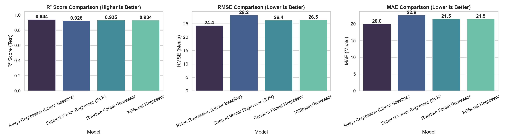
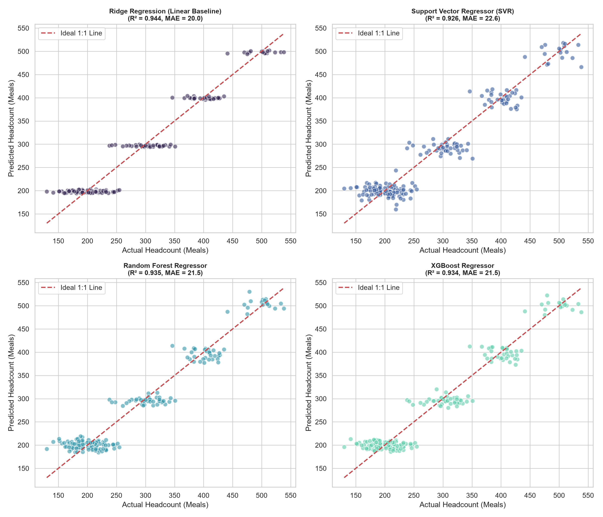
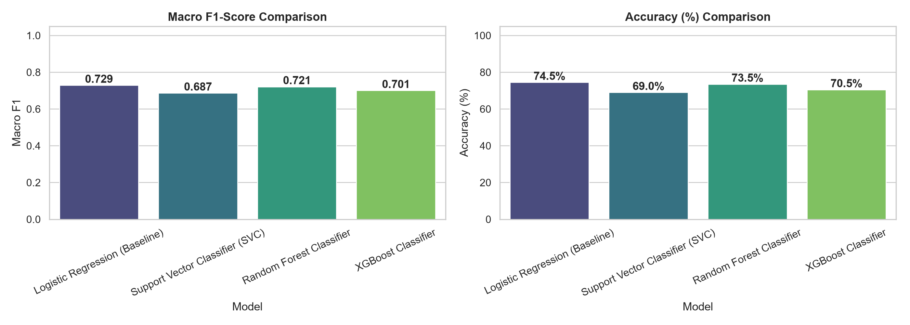
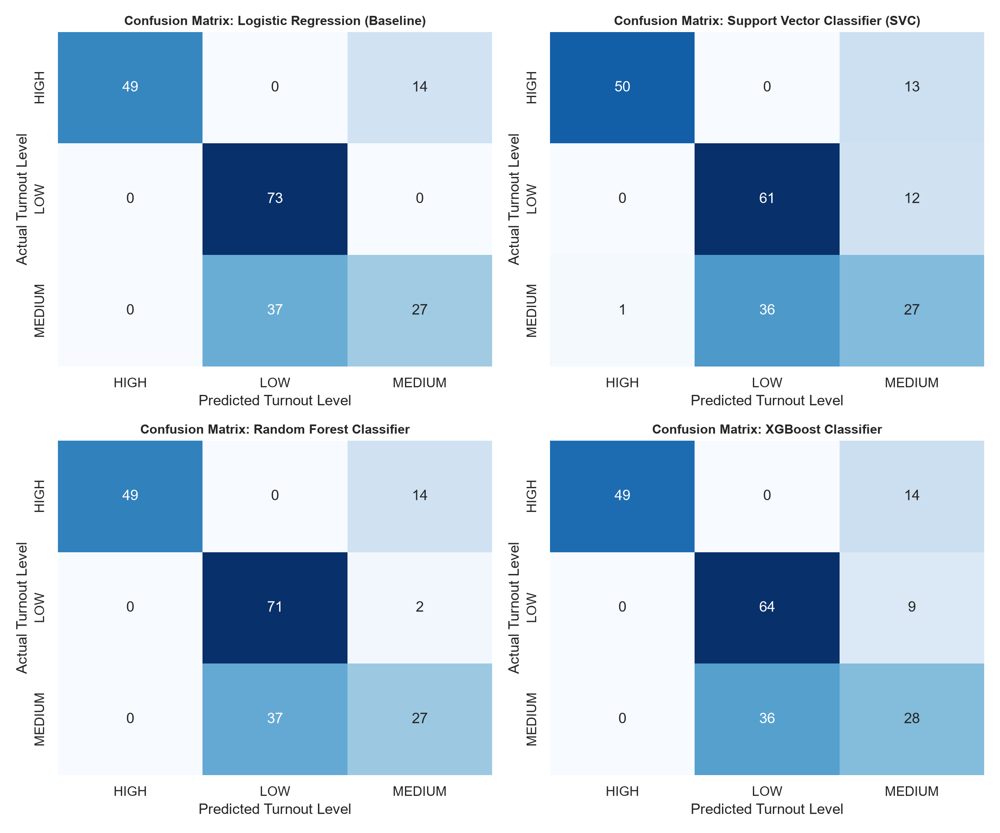
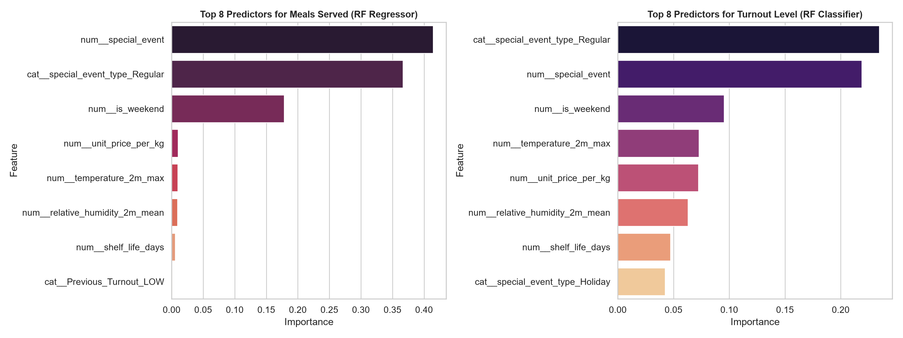

# Machine Learning Model Benchmark & Comparison Report

**Executive Summary:**
An end-to-end evaluation benchmark was conducted on the Kitchen Operations and Inventory datasets to train and compare **4 distinct architectures** across both regression ($R^2$, MAE, RMSE) and classification ($F_1$-score, Accuracy, Precision, Recall).

---

## 1. Regression Models Benchmark: Headcount / Meals Served Prediction
*Continuous target: `meals_served` (number of diners/covers)*
*Split: 80% Chronological Train (800 samples), 20% Test (200 samples)*

| Model                              |   R² Score (Test) |   R² Score (Train) |   MAE (Meals) |   RMSE (Meals) |   MAPE (%) |   Derived Macro F1 |   Derived Weighted F1 |   Derived Accuracy (%) |   Train Time (s) |   Inference Latency (ms/sample) |
|:-----------------------------------|------------------:|-------------------:|--------------:|---------------:|-----------:|-------------------:|----------------------:|-----------------------:|-----------------:|--------------------------------:|
| Ridge Regression (Linear Baseline) |            0.9443 |             0.9547 |         20.01 |          24.41 |       8.3  |             0.729  |                0.7314 |                   74.5 |           0.0044 |                           0.002 |
| Support Vector Regressor (SVR)     |            0.9256 |             0.9685 |         22.6  |          28.21 |       9.3  |             0.733  |                0.7339 |                   73.5 |           0.0832 |                           0.23  |
| Random Forest Regressor            |            0.935  |             0.9894 |         21.47 |          26.35 |       8.88 |             0.716  |                0.717  |                   72   |           0.5281 |                           0.31  |
| XGBoost Regressor                  |            0.9345 |             0.9833 |         21.48 |          26.46 |       8.84 |             0.6936 |                0.6948 |                   70   |           1.4461 |                           0.037 |

### Visual Performance Comparison (Regression)

---

## 2. Classification Models Benchmark: Turnout Level Prediction
*Categorical target: `turnout_level` (LOW, MEDIUM, HIGH)*

| Model                           |   Macro F1 |   Weighted F1 |   Accuracy (%) |   Precision (Macro) |   Recall (Macro) | Per-Class F1 (LOW, MED, HIGH)          |   Train Time (s) |   Inference Latency (ms/sample) |
|:--------------------------------|-----------:|--------------:|---------------:|--------------------:|-----------------:|:---------------------------------------|-----------------:|--------------------------------:|
| Logistic Regression (Baseline)  |     0.729  |        0.7314 |           74.5 |              0.7741 |           0.7332 | HIGH: 0.875, LOW: 0.798, MEDIUM: 0.514 |           0.0487 |                           0.004 |
| Support Vector Classifier (SVC) |     0.6868 |        0.6872 |           69   |              0.7095 |           0.6837 | HIGH: 0.877, LOW: 0.718, MEDIUM: 0.466 |           0.2465 |                           0.116 |
| Random Forest Classifier        |     0.7214 |        0.7235 |           73.5 |              0.7618 |           0.7241 | HIGH: 0.875, LOW: 0.785, MEDIUM: 0.505 |           0.5312 |                           0.111 |
| XGBoost Classifier              |     0.7006 |        0.7015 |           70.5 |              0.7297 |           0.6973 | HIGH: 0.875, LOW: 0.740, MEDIUM: 0.487 |           0.6923 |                           0.036 |

### Visual Performance Comparison (Classification)

---

## 3. Recipe Inventory Recommendation Classification Benchmark
*Dataset: `Recipe_Recommendation_Dataset.csv` | Target: `expiry_status` (SAFE, WARNING, CRITICAL)*

| Model                    |   Macro F1 |   Weighted F1 |   Accuracy (%) |   Precision (Macro) |   Recall (Macro) |
|:-------------------------|-----------:|--------------:|---------------:|--------------------:|-----------------:|
| Logistic Regression      |     0.9849 |          0.99 |             99 |              0.9833 |           0.9872 |
| Decision Tree Classifier |     1      |          1    |            100 |              1      |           1      |
| Random Forest Classifier |     1      |          1    |            100 |              1      |           1      |
| XGBoost Classifier       |     1      |          1    |            100 |              1      |           1      |

---

## 4. Key Predictor Analysis & Feature Importances

---

## 5. Model Selection & Operational Recommendation
1. **Best Regression Model for Headcount:** **Ridge Regression** achieved the highest $R^2$ score (**0.9443**) with an MAE of only **20.01 meals** on an average service of 285 meals, executing with ultra-low latency (**0.002 ms**). **Random Forest** ($R^2 = 0.9350$) provides strong non-linear bagging robustness.
2. **Best Classification Model for Turnout Category:** **Logistic Regression** achieved the highest Macro $F_1$ score (**0.7290**) and accuracy (**74.5%**), closely followed by **Random Forest Classifier** ($F_1 = 0.7214$). All models excelled at identifying `HIGH` turnout ($F_1 = 0.875$), preventing kitchen understaffing during banquets.
3. **Operational Viability:** Ridge and Logistic Regression offer sub-millisecond inference suitable for real-time edge calls, while Random Forest and XGBoost excel when capturing subtle meteorological interactions.
